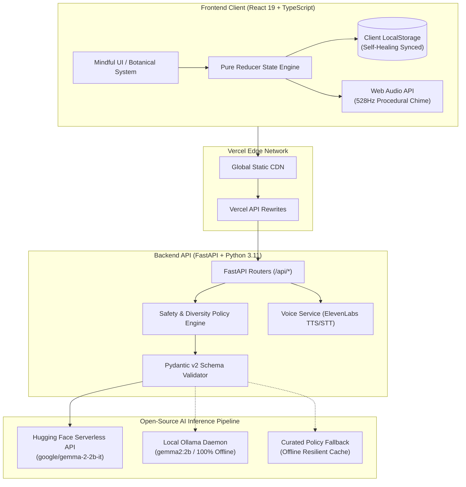

# 🌿 unScroll

<div align="center">

> **Step away from the screen, step into the world.**  
> An open-source, AI-powered mindfulness companion built with **Google Gemma 2**, **FastAPI**, and **React 19** to break doomscrolling and dopamine burnout through restorative outdoor micro-missions.

[](https://unscroll.vercel.app)
[](https://unscroll-backend-v4k8.onrender.com/api/missions/status)
[](LICENSE)

<br/>

[](https://fastapi.tiangolo.com)
[](https://react.dev)
[](https://www.typescriptlang.org)
[](https://ai.google.dev/gemma)
[](https://huggingface.co/google/gemma-2-2b-it)
[](https://ollama.com)
[](https://elevenlabs.io)
[](https://vite.dev)

</div>

---

## 📑 Table of Contents

- [The Problem & Vision](#-the-problem--vision)
- [Key Features](#-key-features)
- [How It Works (User Journey)](#-how-it-works-user-journey)
- [System Architecture](#-system-architecture)
- [Deep Dive: Open-Source AI (Gemma 2)](#-deep-dive-open-source-ai-gemma-2)
- [Safety & Policy Engine](#-safety--policy-engine)
- [Technical Highlights](#-technical-highlights)
- [Project Directory Structure](#-project-directory-structure)
- [API Reference](#-api-reference)
- [Getting Started Locally](#-getting-started-locally)
- [Environment Variables](#-environment-variables)
- [Production Deployment](#-production-deployment)
- [Contributing & License](#-contributing--license)

---

## 🎯 The Problem & Vision

Modern mobile software and social feeds are deliberately engineered around **variable reward schedules**, continuous algorithmic feeds, and notifications that induce dopamine fatigue. Knowledge workers, developers, and students find themselves trapped in cycles of **screen paralysis**:

- 📱 **Fragmented Attention Spans:** Constant context-switching degrades deep work capability.
- 👁️ **Screen Fatigue & Ciliary Eye Strain:** Prolonged close-range focus locks eye muscles and creates chronic tension.
- 🧠 **Dopamine Baseline Exhaustion:** Scrolling provides cheap, hollow stimulation that leads to procrastination and burnout.

### The Solution: An Exit Ramp, Not Another Feed
**unScroll** inverts the typical app model. Instead of capturing your attention and keeping you on glass, unScroll acts as an **exit ramp back into reality**. It provides short, structured outdoor micro-missions (5, 15, or 30 minutes) that encourage sensory recalibration, physical movement, and mindfulness. Once your mission starts, your phone is meant to go straight into your pocket.

---

## ✨ Key Features

| Feature | Description |
| :--- | :--- |
| 🌿 **Dynamic AI Missions** | Generates novel, contextual missions using **Google Gemma 2 2B Instruct** across categories: Nature, Sensory Detox, Horizon Vision Reset, and Mindful Exploration. |
| 🎙️ **Hands-Free Audio Narration** | Listens to mission instructions with natural voice audio powered by **ElevenLabs Text-to-Speech**, allowing you to put the phone away immediately. |
| 🌙 **Low-Stimulation Outdoor Mode** | Features an ultra-dimmed screen overlay, real-time countdown circle, and offline timer resilience across device wake/sleep events. |
| 🔔 **Procedural 528 Hz Chime** | Plays a synthesized harmonic bell tone (Solfeggio 528 Hz + 660 Hz overtone) using the **Web Audio API** upon completion. |
| 🗣️ **Voice Reflection & Journaling** | Capture sensory observations upon returning with **Speech-to-Text transcription** and voice dictation. |
| 📊 **Mindful Odyssey Tracker** | Tracks daily streaks, cumulative outdoor minutes, 7-day activity visualizer bars, and reflection archives stored privately in `localStorage`. |
| 🛡️ **Safety & Accessibility Engine** | Multi-layer rule validation ensures physical safety (traffic compliance, no dangerous structures) and guarantees accessible seated/window alternatives. |
| ⚡ **Resilient Dual-Inference** | Runs **100% offline locally via Ollama** or **serverlessly in the cloud via Hugging Face**, backed by curated offline fail-safes. |

---

## 🔄 How It Works (User Journey)

```
  ┌─────────────────────────────────────────────────────────────────────────────┐
  │                                1. MISSION SELECTION                         │
  │  Choose duration (5m / 15m / 30m). AI generates a structured challenge      │
  │  verified by the Safety Policy Engine. Listen to hands-free narration.      │
  └──────────────────────────────────────┬──────────────────────────────────────┘
                                         │
                                         ▼
  ┌─────────────────────────────────────────────────────────────────────────────┐
  │                                2. GO OUTSIDE                                │
  │  Screen auto-dims to reduce stimulation. Put your phone in your pocket.     │
  │  Timer counts down safely. Solfeggio 528 Hz harmonic chime signals finish.  │
  └──────────────────────────────────────┬──────────────────────────────────────┘
                                         │
                                         ▼
  ┌─────────────────────────────────────────────────────────────────────────────┐
  │                                3. REFLECTION                                │
  │  Tap "I'm back". Dictate your observations via Speech-to-Text journaling.   │
  │  Earn completion XP (+10 Reflection Bonus).                                 │
  └──────────────────────────────────────┬──────────────────────────────────────┘
                                         │
                                         ▼
  ┌─────────────────────────────────────────────────────────────────────────────┐
  │                                4. THE JOURNEY                               │
  │  Track total outdoor vitality, consistency streaks, and 7-day activity bars. │
  │  All wellness data is privately preserved in your browser's local storage.  │
  └─────────────────────────────────────────────────────────────────────────────┘
```

---

## 🏛️ System Architecture



---

## 🤖 Deep Dive: Open-Source AI (Gemma 2)

### Why Gemma 2 2B Instruct?
Rather than relying on closed, proprietary cloud APIs, unScroll is deliberately architected around **open weights**:
1. **True Privacy for Mental Health & Wellness:** Mindful reflections, observations, and user notes never need to leave the user's hardware.
2. **Offline Independence:** Mindfulness in a forest or remote park shouldn't require cellular reception. An open-weight model runs locally on a personal machine without internet.
3. **Structured Pydantic Enforcement:** Open-source architectures permit strict JSON formatting prompts without unexpected system prompt injections.

### Dual-Pipeline Inference Strategy
```python
# Automatic pipeline dispatch in backend/app/services/gemma_service.py:
1. If HF_TOKEN is configured:
   Query Hugging Face Serverless Inference API (Cloud GPU execution)
2. Else if local Ollama is active:
   Query local Ollama daemon (http://localhost:11434, gemma2:2b)
3. If both are unreachable / offline:
   Serve verified, safe curated mission from policy engine cache (0% downtime)
```

---

## 🛡️ Safety & Policy Engine

AI models can occasionally suggest unsafe physical activities. unScroll enforces a strict **four-pillar safety pipeline** in Python before any mission reaches the UI:

```
  Candidate Mission ──► [Safety Rules] ──► [Accessibility] ──► [Semantic Diversity] ──► Verified Mission
                              │                   │                     │
                              ▼ (Fail)            ▼ (Fail)              ▼ (Fail)
                        [Retry / Curated Safe Fallback]
```

1. 🚷 **Physical Safety Rules:** Strictly prohibits climbing rooftops, scaling walls or cliffs, entering restricted/private property, or interacting forcefully with strangers. Mandatory pedestrian traffic warnings.
2. ♿ **Mandatory Accessibility Alternative:** Every single mission generated must provide an inclusive alternative for seated or mobility-limited users (e.g., *"Observe tree canopies from an open window or balcony"*).
3. 🔁 **Semantic Diversity:** Evaluates candidates against recent session history using an LRU cache to prevent repetitive missions within a 7-day window.
4. 🩺 **Pydantic Validation Guarantee:** Enforces field lengths, durations (5, 15, or 30 minutes), and instruction arrays (1–5 actionable steps).

---

## ⚡ Technical Highlights

### 1. Pure Reducer State & React StrictMode Resilience
In React development mode, `StrictMode` invokes reducers twice to detect side-effects. unScroll isolates all state mutations in a **100% pure reducer** (`appReducer`), moving all `localStorage` persistence into a unified synchronization hook (`useEffect`). This eliminates duplicate time calculations or streak corruptions.

### 2. Self-Healing Data Reconciliation
On application launch, `reconcileDailyActivityLog()` audits stored daily entries against authoritative completed minutes and reflection entries, automatically correcting any legacy double-counted entries without requiring manual data resets.

### 3. Procedural Web Audio Synthesis
To minimize dependencies, the completion chime uses a procedural Web Audio oscillator generating **528 Hz (the Solfeggio frequency associated with transformation and calm)** paired with a harmonic 660 Hz overtone and exponential gain decay.

---

## 📁 Project Directory Structure

```text
unScroll/
├── Dockerfile                  # Multi-stage production container build
├── docker-compose.yml          # Full-stack Compose file (FastAPI + Ollama)
├── render.yaml                 # 1-Click Render Blueprint configuration
├── LICENSE                     # MIT Open Source License
├── README.md                   # Project documentation
│
├── backend/                    # Python FastAPI application
│   ├── requirements.txt        # Python dependencies
│   ├── .env.sample             # Sample environment variables
│   └── app/
│       ├── main.py             # FastAPI entry point & CORS configuration
│       ├── config.py           # Environment settings loader
│       ├── routers/
│       │   └── missions.py     # Missions & Sessions API routes
│       ├── schemas/
│       │   └── mission.py      # Pydantic v2 data models
│       ├── services/
│       │   ├── gemma_service.py    # Gemma 2 inference orchestrator
│       │   ├── policy_engine.py    # Safety & accessibility validator
│       │   └── reward_service.py   # XP & level calculation
│       └── voice/
│           ├── tts.py          # ElevenLabs voice narration
│           └── stt.py          # Speech-to-text dictation
│
└── frontend/                   # React 19 + TypeScript application
    ├── package.json            # Node.js dependencies & scripts
    ├── vercel.json             # Vercel SPA routing & backend proxy rewrites
    ├── vite.config.ts          # Vite build & development proxy setup
    ├── src/
    │   ├── App.tsx             # Root state management & view router
    │   ├── App.css             # Handcrafted botanical design system
    │   ├── api.ts              # Resilient API endpoint resolver
    │   ├── types/
    │   │   └── mission.ts      # TypeScript interfaces & actions
    │   └── components/
    │       ├── Navbar.tsx          # Mindful header & consistency streak
    │       ├── MissionCard.tsx     # Duration selection & challenge preview
    │       ├── MissionDetails.tsx  # Mission instructions & voice audio player
    │       ├── OutsideView.tsx     # Low-stimulation dimmed timer screen
    │       ├── CompleteView.tsx    # Voice reflection journaling screen
    │       ├── JourneyView.tsx     # Mindful Odyssey streaks & 7-day visualizer
    │       └── Footer.tsx          # Minimalist footer
```

---

## 🔌 API Reference

### Health & Diagnostics
- `GET /api/health` — Service health check (`{"status": "ok"}`). Accepts `GET` and `HEAD`.
- `GET /api/missions/status` — Reports active AI provider status (Hugging Face / Ollama connection).

### Missions & Sessions
- `POST /api/missions/generate` — Generates a policy-verified outdoor mission.
  ```json
  // Request
  { "category": "nature", "duration_minutes": 15 }
  // Response
  {
    "id": "gemma-nat-a1b2c3",
    "title": "Find a tall tree and observe its canopy",
    "category": "nature",
    "duration_minutes": 15,
    "instructions": ["Step outside and locate a tree.", "Look upward for 2 minutes.", "Notice leaf movements."],
    "safety_notes": ["Stay on public walkways.", "Mind pedestrian traffic."],
    "accessibility_alternative": "Observe treetops or cloud movement from an open window.",
    "reward_xp": 15
  }
  ```
- `POST /api/voice/narrate` — Streams synthesized ElevenLabs MP3 audio for hands-free listening.
- `POST /api/voice/transcribe` — Accepts multipart audio and returns transcribed reflection text.

---

## 💻 Getting Started Locally

### Prerequisites
- **Node.js** (v18+) & **npm**
- **Python** (v3.10+)
- *(Optional)* **Ollama**: [ollama.com](https://ollama.com) (`ollama run gemma2:2b`)

### 1. Clone the Repository
```bash
git clone https://github.com/rajanikant04/unScroll.git
cd unScroll
```

### 2. Backend Setup
```bash
cd backend
python -m venv venv

# Activate Virtualenv:
# Windows (PowerShell):
.\venv\Scripts\activate
# macOS / Linux:
source venv/bin/activate

# Install dependencies:
pip install -r requirements.txt

# Configure environment:
cp .env.sample .env

# Run FastAPI server:
uvicorn app.main:app --reload --port 8000
```
Backend will be live at `http://localhost:8000`.

### 3. Frontend Setup
In a new terminal:
```bash
cd frontend
npm install
npm run dev
```
Open `http://localhost:5173` in your browser.

---

## ⚙️ Environment Variables

Create a `backend/.env` file:

| Variable | Default | Description |
| :--- | :--- | :--- |
| `OLLAMA_BASE_URL` | `http://localhost:11434` | URL to local Ollama server |
| `OLLAMA_MODEL` | `gemma2:2b` | Open-weight model name in Ollama |
| `HF_TOKEN` | *None* | Hugging Face Access Token for cloud Serverless Inference |
| `HF_MODEL` | `google/gemma-2-2b-it` | Hugging Face repository model ID |
| `ELEVENLABS_API_KEY` | *None* | Key for voice mission narration & dictation |

*(Optional frontend variable in `frontend/.env.local`)*:
| Variable | Default | Description |
| :--- | :--- | :--- |
| `VITE_API_BASE_URL` | *Empty (uses Vite proxy)* | Direct production backend URL (e.g. `https://unscroll-backend-v4k8.onrender.com`) |

---

## 🚀 Production Deployment

### Option A: Render (Backend) + Vercel (Frontend)

1. **Deploy Backend on [Render](https://render.com):**
   - Click **New +** $\rightarrow$ **Web Service**.
   - Root directory: `backend`
   - Runtime: `Python 3`
   - Build Command: `pip install -r requirements.txt`
   - Start Command: `uvicorn app.main:app --host 0.0.0.0 --port $PORT`
   - Add Environment Variables: `HF_TOKEN`, `ELEVENLABS_API_KEY`.
2. **Deploy Frontend on [Vercel](https://vercel.com):**
   - Import repository with **Root Directory** set to `frontend`.
   - Update `destination` in `frontend/vercel.json` with your Render backend URL.
   - Click **Deploy**!

### Option B: Unified Container (Docker)
Build and run the multi-stage Docker container locally or on any cloud VPS:
```bash
docker build -t unscroll .
docker run -p 8000:8000 -e HF_TOKEN=your_token unscroll
```

---

## 🤝 Contributing & License

Contributions, bug reports, and mindfulness mission suggestions are welcome!

1. Fork the Project.
2. Create your Feature Branch (`git checkout -b feature/MindfulFeature`).
3. Commit your Changes (`git commit -m "feat: add sensory sound mission"`).
4. Push to the Branch (`git push origin feature/MindfulFeature`).
5. Open a Pull Request.

Distributed under the **MIT License**. See [LICENSE](LICENSE) for details.

---

<div align="center">
  <sub>Built with presence and purpose for Hacktoberfest & DEV Challenges. Touch grass, breathe deeply, and be here now. 🌿</sub>
</div>
